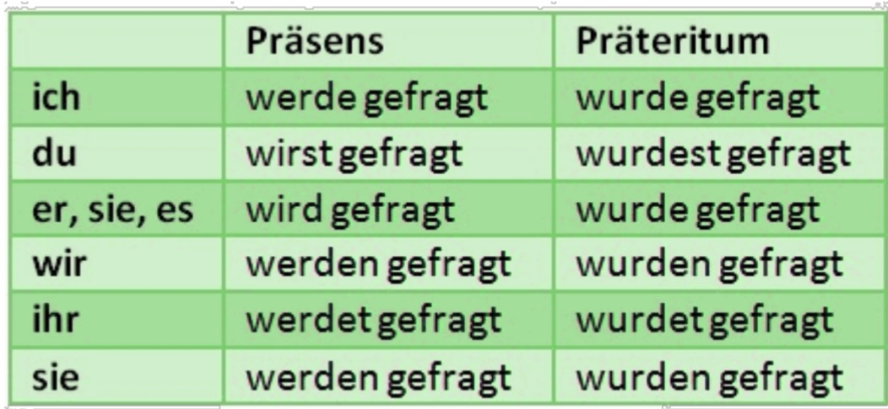
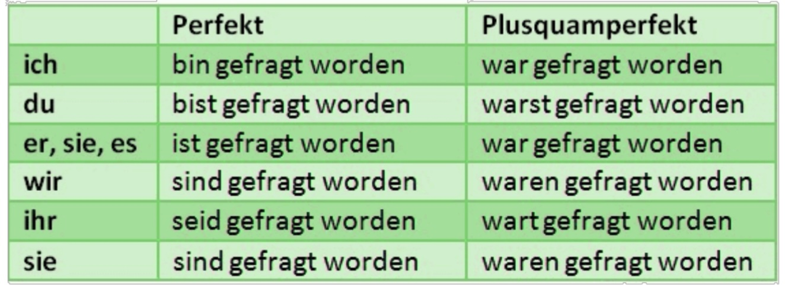
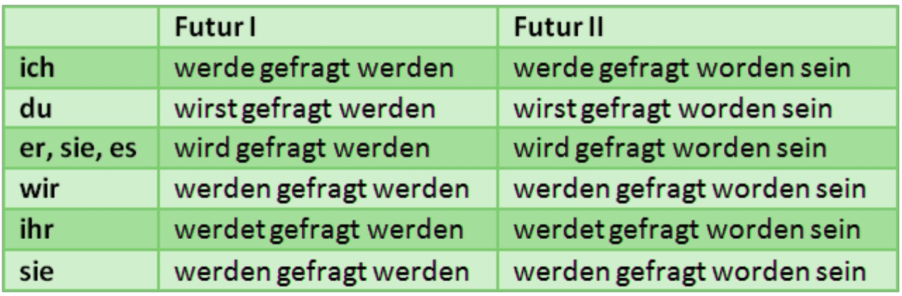

# Глаголы

## Highlights

- После Lassen всегда Akk
- Zu примерно тоже самое, что в английском "to". Глагол после всегда в инфинитиве
- Passiv: werden в нужной форме + Partizip II

## Возвратные

- Sich стремтися на 3 место, оттуда его может сместить только существительное  
*Morgen interessiere ich **mich***

## Lassen

Назначения (по мере убывания значимости)

1. Оставлять, не брать с собой  
*Kann ich meine Koffer hier **lassen**?*
1. (не)Позволять  
*Ich **lasse** meine Haare **schneiden**. Ich **lasse** mein Kind nicht **fehrnsehen**.*
1. Призыв к действию ("давай")  
Всегда Imperativ/с uns/нет перфекта  
***Lass(t)** uns gehen!*

### Прошедшее время

- gelassen только для "оставлять"  
Он *главный* глагол  
*Ich habe meinen Koffer hier **gelassen**. Ich habe meine Haare shcneiden **lassen***
- в остальных случаях просто lassen  
Он *вспомогательный* глагол: (Verb +) lassen    
*Ich habe mein Auto reparieren **lassen**. Ich habe mein Kind nicht fehrnsehen **lassen***
- ließ/ließt/ließ/ließen

## Zu + Infinitiv

- Если в предложении два смысловых глагола, между ними хорошо входит zu  
*Ich **plane** morgen **zu beginnen***
- Zu не ставится
  - с модальными глаголами  
  *Ich **muss** heute viel **arbeiten**.*Wrong: *Ich muss zu arbeiten.*
  - прямо перед lassen, sehen, fahren, hören, bleiben, gehen  
  Исключение um ... zu в значении "*идти для того, чтобы ...*" = "*gehen ..., um ... zu [<i>Verb</i>]*"  
  *Er **lässt** sein Auto **reparieren**.*Wrong: *Er lässt sein Auto zu reparieren.*  
  *Wir **gehen** heute Abend **tanzen**. Wir gehen zu tanzen.*  
  *Ich **gehe** in den Park, um Sport **zu treiben**. (Я иду в парк, чтобы заниматься спортом).*  
  *Ich habe versucht, **um** (может быть опущен - но запятая останется!) wie moeglich schnell **zu gehen/kommen***
  - в будущем времени (werden)  
    *Ich **werde** bald nach Berlin **fahren**.*Wrong: *Ich werde bald nach Berlin zu fahren.*  
  - в konjuktiv 2  
  *Ich **hätte** gern **schlafen***

## Управление глаголов

- [pdf](./assets/001-verb-conjugation.pdf)

## Страдательный залог / Passiv

- [pdf](./assets/002-verb-passive.pdf)

Passiv образуется при помощи вспомогательного глалога werden *в соответствующей временной форме* и Partizip II  
*Ein interessantes Buch **wird** von dem Jungen **gelesen***. Aktiv: *Der Junge **liest** ein interresantes Buch.*

> [!TIP]
> werden - wurde - geworden

> [!CAUTION]
> Perfekt Passiv и Plusquamperfekt Passiv употребляется старая форма Partizip II - worden (не geworden)

- Von + *Dat* - указывает на действующее лицо (часто *одушевленное*). *Das Haus wird **von** dem Bauarbeiter gebaut.*
- Durch + *Akk* - на указывает на средство, причину или инструмент, посредством чего произошло действие (часто *неодушевленное*). *Das Problem wird **durch** ein Update gelöst.*

### В Passiv не употребляются

- bekommen - получать
- interessieren - интересовать
- besitzen - обладать
- kennen - знать
- enthalten - содержать в себе
- kosten - стоить
- erfahren - узнавать
- wissen - знать
- haben - иметь
- kennenlernen - знакомиться
